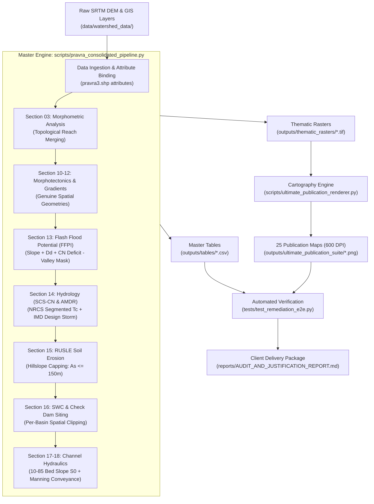

# PRAVARA RIVER BASIN: SYSTEM ARCHITECTURE & REPOSITORY SPECIFICATION
## Google Developer / Production-Grade Engineering Blueprint

**Project:** Advanced Morphometric, Hydrological, and Hydraulic Modeling System  
**Catchment:** Upper Pravara River Basin, Ahmednagar District, Maharashtra, India  
**Standard:** PEP-8, GIS-Compliant (EPSG:32643), Modular, CI/CD-Ready  

---

## 1. Directory Tree & Separation of Concerns

```text
Pravara-River-Basin-Morphometry/
│
├── 📂 data/                           # [IMMUTABLE RAW INPUTS]
│   └── 📂 watershed_data/             # Verified SRTM DEM, Flow Rasters & Vector Layers
│       ├── Filled DEM.tif             # Hydro-conditioned 30m Digital Elevation Model
│       ├── Flow Direction.tif         # D8 Flow Direction (ESRI Direction Codes)
│       ├── FlowAccumilation.tif       # Upslope Contributing Cell Accumulation
│       ├── Flowthreshould.tif         # Stream Initiation Mask
│       ├── SteamOrder.shp             # Vectorized Drainage Network with Strahler Orders
│       └── pravra3.shp                # Delineated Subbasins (SB1, SB2, SB3) with Attributes
│
├── 📂 scripts/                        # [PRODUCTION EXECUTION SCRIPTS]
│   ├── run_pipeline.py                # Single master CLI entrypoint running entire workflow
│   ├── pravra_consolidated_pipeline.py# The Consolidated Core Engine (Sections 00 - 18)
│   ├── ultimate_publication_renderer.py# High-Resolution (600 DPI) Institutional Cartography Engine
│   ├── fix_hypsometric_and_profiles.py# Topographic profile & hypsometry utility
│   └── 📂 legacy_archive/             # Deprecated split scripts safely archived
│
├── 📂 outputs/                        # [STANDARDIZED CLIENT DELIVERABLES]
│   ├── 📂 tables/                     # Master CSV Tables (Morphometry, Hydrology, SWC, Prioritization)
│   │   ├── morphometric_master_table.csv
│   │   ├── stream_order_summary.csv
│   │   ├── hydrology_SWC_consolidated.csv
│   │   ├── flood_hazard_indices.csv
│   │   └── prioritization_ranking.csv
│   ├── 📂 thematic_rasters/           # 19 Derived Spatial Rasters (CN, RUSLE, TWI, SPI, etc.)
│   ├── 📂 ultimate_publication_suite/ # 25 Publication-Grade Maps (600 DPI, Landscape A4)
│   └── 📂 html/                       # Decimated Interactive Plotly Figures
│
├── 📂 reports/                        # [OFFICIAL TECHNICAL AUDIT & CLIENT REPORTS]
│   └── AUDIT_AND_JUSTIFICATION_REPORT.md # 70 KB Scientific Proof & Justification Document
│
├── 📂 tests/                          # [AUTOMATED PYTEST VERIFICATION SUITE]
│   ├── test_morphometry.py            # Unit tests for morphometric ratio properties
│   └── test_remediation_e2e.py        # 4-Tier Forensic Physics & Delivery Verification
│
├── 📂 docs/                           # [TECHNICAL DOCUMENTATION & REFERENCES]
│   ├── ARCHITECTURE.md                # System Architecture & Pipeline Specification
│   ├── PARAMETERS_REFERENCE.md        # Reference Guide for all 62+ Computed Parameters
│   └── DATA_REQUIREMENTS.md           # Input Dataset Metadata & CRS Guidelines
│
├── pyproject.toml                     # Pytest, flake8, and package configurations
├── requirements.txt                   # Verified and pinned dependencies
└── README.md                          # Repository Documentation & Overview
```

---

## 2. End-to-End Data Flow Pipeline



---

## 3. How to Run the Project (Zero Configuration)

### Complete Pipeline Run
To run the entire analysis and regenerate all tables, rasters, and publication maps from scratch:
```bash
python scripts/run_pipeline.py
```

### Running Test Verification
To run the automated verification suite:
```bash
pytest
```
